# Практическая работа «Основы работы с Linux»

Москалева Александра, группа 3-ИСП9-54

Задание: [linux_fundamentals.md](https://github.com/softboxdev/programming_course/blob/main/practice/linux_fundamentals.md)

Выполняла в Ubuntu (WSL).

## Файлы

- `commands.sh` - команды частей 1-4
- `5_myfirstscript.sh` - часть 5 (myfirstscript.sh)
- `extra_tasks.sh` - доп. задания 1 и 2
- `system_info.sh` - доп. задание 3
- `screenshots/` - скриншоты

## Контрольные вопросы

**1. Какая команда показывает содержимое текущей директории?**
`ls`. С ключом `-l` выводит подробный список (права, владелец, размер, дата), с `-a` показывает и скрытые файлы, которые начинаются с точки. Часто пишут вместе: `ls -la`.

**2. Как создать новую директорию?**
`mkdir имя_папки`. Можно создать сразу несколько: `mkdir documents projects downloads`. С ключом `-p` создаются и все промежуточные папки, и не будет ошибки, если папка уже есть: `mkdir -p myproject/src/main`.

**3. Как скопировать файл с сохранением прав?**
`cp -p файл куда`. Ключ `-p` сохраняет права доступа, владельца и время изменения. Для папок используют `cp -a`: он копирует рекурсивно и тоже сохраняет все атрибуты.

**4. Чем отличается `>` от `>>`?**
Оба перенаправляют вывод команды в файл. `>` перезаписывает файл: старое содержимое удаляется. `>>` дописывает в конец и сохраняет то, что было. Если файла нет, оба его создают.

**5. Как найти все файлы с расширением .txt?**
`find . -name "*.txt"`. Точка значит «искать в текущей папке и во всех вложенных», `*` означает любые символы. Чтобы искать только файлы, без папок, добавляют `-type f`.

**6. Как сделать файл исполняемым?**
`chmod +x файл`. После этого его можно запускать как программу: `./файл`. Числовой вариант: `chmod 755 файл` (владелец может всё, остальные читать и запускать).

**7. Как посмотреть IP-адрес компьютера?**
В Linux командой `ip addr` (или коротко `hostname -I`). Она показывает адреса всех сетевых интерфейсов: `127.0.0.1` - это сам компьютер (loopback), остальные - адреса в сети. Внешний IP можно узнать через `curl ifconfig.me`.

**8. Что делает команда grep?**
Ищет строки, в которых есть заданный текст или шаблон, в файле или в выводе другой команды. Полезные ключи: `-i` без учёта регистра, `-v` строки без совпадения, `-c` количество строк, `-r` поиск по папке, `-E` расширенные регулярные выражения.

## Доп. задания

1. Структура папок: `mkdir -p myproject/{src/{main,test},docs,logs,backup}`
2. 5 самых больших .log: `find . -name "*.log" -type f -exec ls -lS {} + | head -5`
3. Скрипт `system_info.sh`: имя хоста, ядро, память, процессы, пользователь, uptime.

## Скриншоты

1.1 Навигация

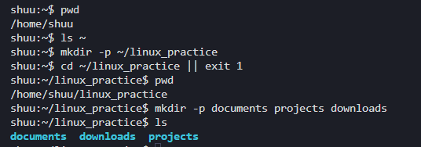

1.2 Создание файлов

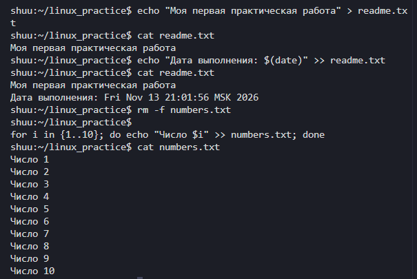

1.3 Копирование и перемещение

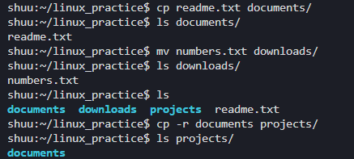

2.1 Поиск файлов

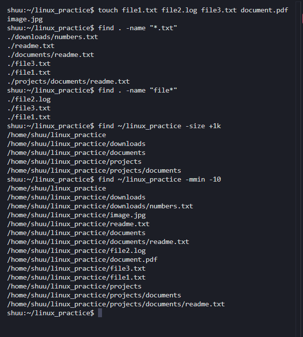

2.2 grep

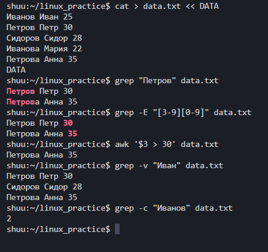

2.3 Конвейеры

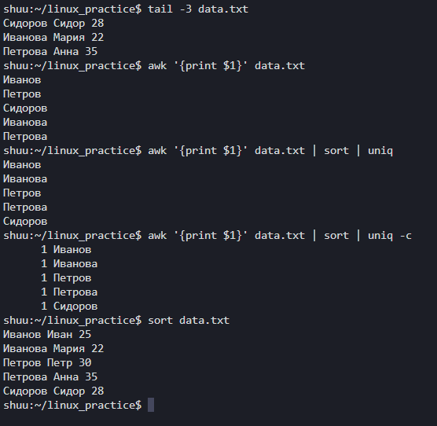

3 Права доступа

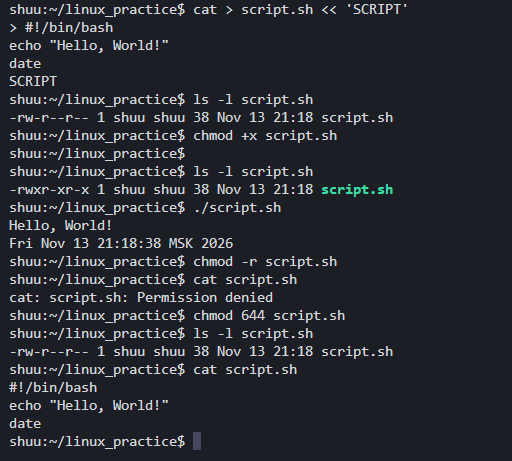

4.1 ping

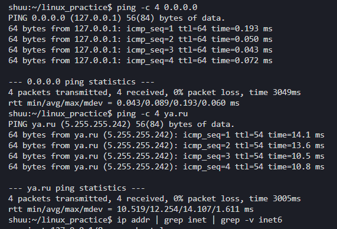

4.2 DNS и curl

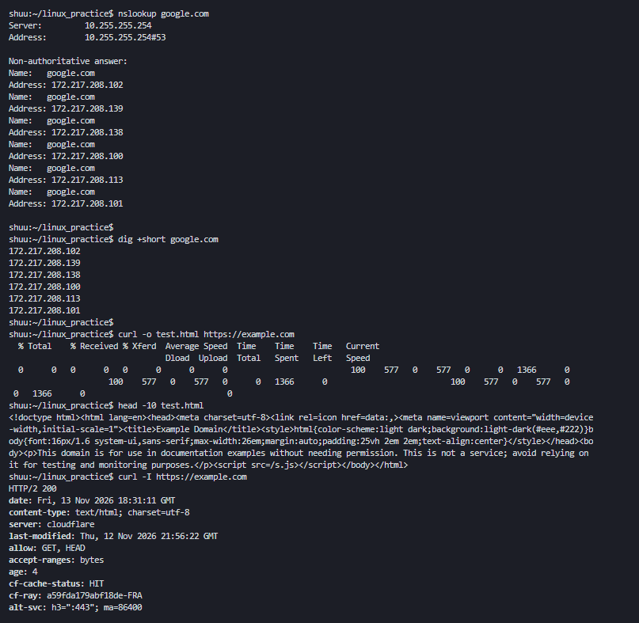

5 myfirstscript.sh

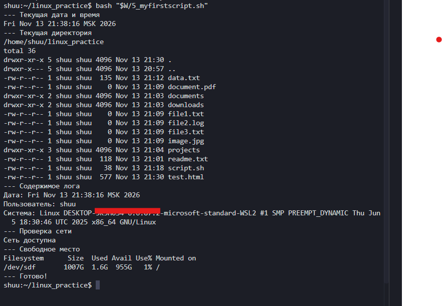

Доп. задания 1 и 2

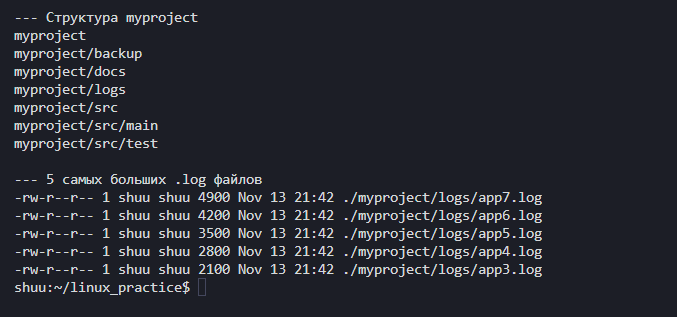

Доп. задание 3

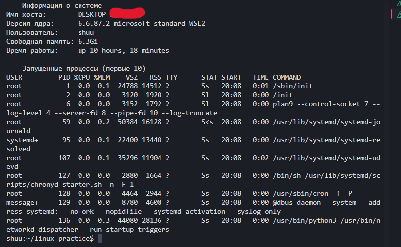
