# Практическая работа «Основы Bash-скриптинга»

Москалева Александра, группа 3-ИСП9-54

Задание: [practice_basics_syntax.md](https://github.com/softboxdev/programming_course/blob/main/practice/practice_basics_syntax.md)

## Запуск

Выполняла в Ubuntu (WSL).

```bash
chmod +x *.sh
./2_first_script.sh
```

Скрипты из разделов 8 и 10 требуют прав root: `sudo ./8_error_handling.sh`, `sudo ./10_good_backup.sh`.

## Скрипты

Названия файлов совпадают с номерами разделов методички.

- `2_first_script.sh` - 2. Первый скрипт
- `3.1_variables.sh` - 3. Переменные
- `3.2_input.sh` - 3. Ввод данных (пароль скрыт)
- `4.1_if.sh` - 4. Условие if
- `4.2_check_file.sh` - 4. Проверка файла
- `5.1_for.sh` - 5. Цикл for
- `5.2_while.sh` - 5. Цикл while
- `6_functions.sh` - 6. Функции
- `7.1_port_scan.sh` - 7. Сканер портов (сканирую свой компьютер 127.0.0.1)
- `7.2_monitor.sh` - 7. Мониторинг системы
- `7.3_backup.sh` - 7. Резервное копирование
- `7.4_update.sh` - 7. Обновление системы
- `8_error_handling.sh` - 8. Обработка ошибок
- `9_debug.sh` - 9. Отладка (set -x, ещё можно `bash -x скрипт.sh`)
- `10_good_backup.sh` - 10. Хорошо оформленный скрипт

## Что узнала

- `#!/bin/bash` в первой строке говорит, чем запускать скрипт.
- Переменные пишутся без пробелов: `name="Анна"`, используются через `$name`.
- Числа сравниваются через `-eq -gt -lt`, строки через `=` и `!=`, файлы проверяются `-f -d -r`.
- `set -e` останавливает скрипт при ошибке, `set -x` показывает каждую команду (удобно для отладки).

## Скриншоты

2 Первый скрипт

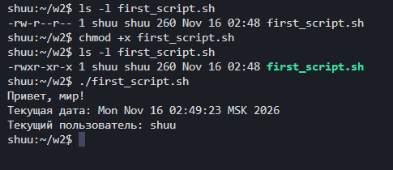

3.1 Переменные

Скриншоты 3.1-4.2 сделаны до того, как файлы были переименованы по разделам методички, поэтому в терминале старые имена (`02_variables.sh`, `03_input.sh`, `04_if_number.sh`, `05_check_file.sh`).

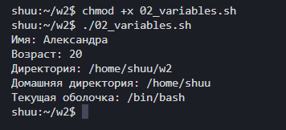

3.2 Ввод данных

После выполнения этого задания файлы были переименованы. На скриншоте первая версия скрипта, она ещё выводила длину пароля.

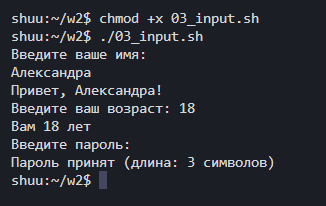

4.1 Условие if

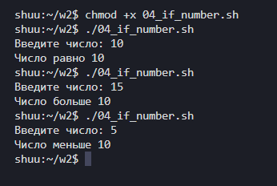

4.2 Проверка файла

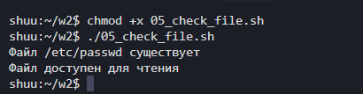

5.1 Цикл for

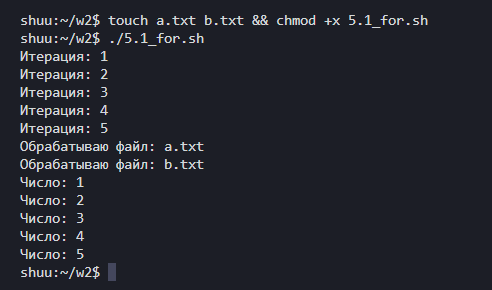

5.2 Цикл while

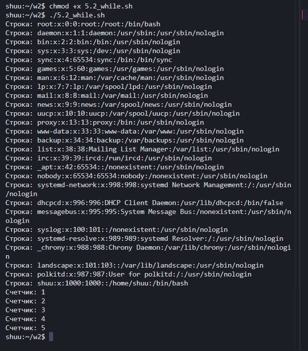

6 Функции

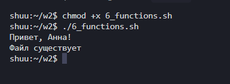

7.1 Сканер портов

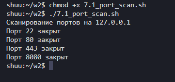

7.2 Мониторинг системы

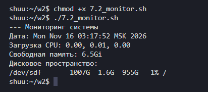

7.3 Резервное копирование

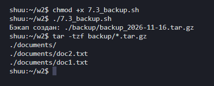

7.4 Обновление системы: начало

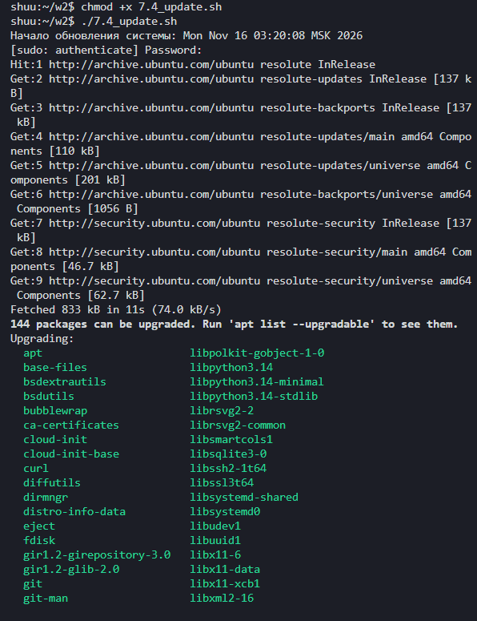

7.4 Обновление системы: конец

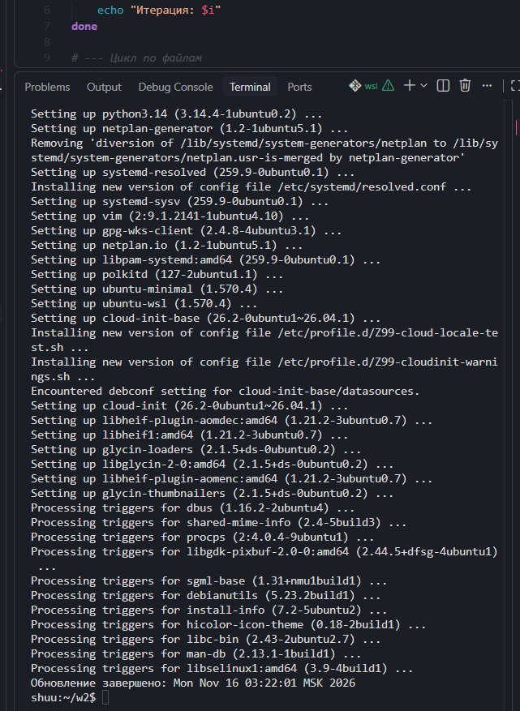

8 Обработка ошибок

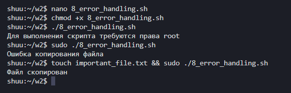

9 Отладка

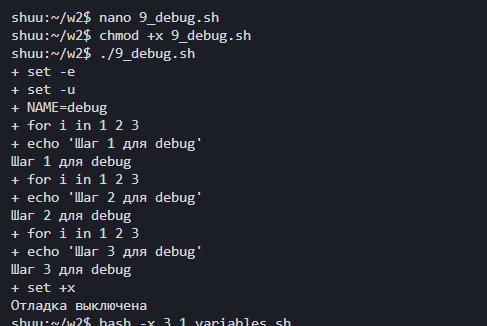

10 Хорошо оформленный скрипт

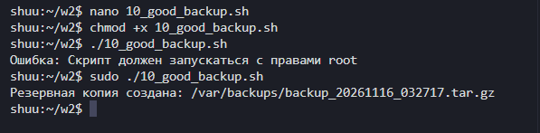
