# Практическая работа «Вычислительные операции в bash»

Москалева Александра, группа 3-ИСП9-54

Задание: [practice_basics_computation.md](https://github.com/softboxdev/programming_course/blob/main/practice/practice_basics_computation.md)

## Запуск

Выполняла в Ubuntu (WSL), скрипты набирала в nano в папке `~/bash_math`, как в методичке.

```bash
chmod +x *.sh
./1.2_hello.sh
./5.2_time.sh 3661
```

## Файлы

Названия файлов совпадают с частями и заданиями методички.

- `test_nano.txt` - часть 0, задание 0 (nano)
- `1.1_hello.sh` - часть 1, первый скрипт
- `1.2_hello.sh` - задание 1 (имя и дата)
- `2.1_sum.sh` - часть 2, сумма
- `2.2_all_ops.sh` - часть 2, все операции
- `2.3_my_math.sh` - задание 2 (x = 25, y = 4)
- `3.1_vars.sh` - часть 3, переменные
- `3.2_counter.sh` - часть 3, счётчик
- `3.3_rectangle.sh` - задание 3 (прямоугольник 8 x 5)
- `4.1_input.sh` - часть 4, ввод чисел
- `4.2_calc.sh` - задание 4 (калькулятор с %)
- `5.1_discount.sh` - задание 5 (скидка, предупреждение больше 50%)
- `5.2_time.sh` - задание 6 (секунды аргументом или через read)
- `5.3_sum_range.sh` - задание 7 (сумма и факториал)
- `6.1_float.sh` - часть 6, площадь круга через bc
- `6.2_average.sh` - задание 8 (среднее с двумя знаками)
- `hw_1.sh` - `hw_4.sh` - доп. задания

## Контрольные вопросы

**1. Почему в bash нельзя написать `a = 10` с пробелами? Что произойдёт?**
Bash делит строку на слова по пробелам. `a = 10` он понимает как запуск команды `a` с аргументами `=` и `10`, поэтому будет ошибка `a: command not found`, а переменная не создастся. Присваивание пишется слитно: `a=10`.

**2. Почему `$((10 / 3))` возвращает 3, а не 3.33?**
Встроенная арифметика bash работает только с целыми числами. При делении дробная часть просто отбрасывается (без округления). Остаток можно получить отдельно: `$((10 % 3))` даёт 1.

**3. Чем `$(( ... ))` отличается от `$( ... )`?**
`$(( 2 + 3 ))` - арифметика: вычисляет выражение и подставляет число 5. `$( date )` - подстановка команды: выполняет команду и подставляет то, что она вывела.

**4. Что делает `read -p "текст: " x`?**
Показывает подсказку `текст: ` в той же строке, ждёт, пока пользователь что-то введёт и нажмёт Enter, и сохраняет введённое в переменную `x`.

**5. Что произойдёт, если поделить на ноль в bash? Почему это нужно проверять?**
Bash выдаст ошибку `division by 0` и не посчитает выражение, а со `set -e` скрипт вообще остановится. Число часто вводит пользователь, поэтому перед делением нужно проверить `if [ "$b" -ne 0 ]` и вывести понятное сообщение.

**6. Зачем в `[ "$b" -ne 0 ]` нужны кавычки вокруг `$b`?**
Если переменная пустая, без кавычек получится `[ -ne 0 ]`, и будет ошибка `unary operator expected`. С кавычками пустая строка остаётся отдельным аргументом. Ещё кавычки защищают, если в значении есть пробелы.

**7. Как посчитать дробные числа в bash?**
Через программу `bc`: `echo "scale=2; 10 / 3" | bc` выведет `3.33`, где `scale` - число знаков после запятой. Ещё можно через `awk`: `awk 'BEGIN { printf "%.2f", 10/3 }'`.

**8. Что означает `;;` в конструкции `case`?**
Это конец одной ветки `case`, как `break` в `switch` в других языках. После него bash выходит из `case` и остальные варианты не проверяет.

**9. Какие три действия нужно выполнить в nano, чтобы сохранить файл и выйти?**
`Ctrl+O` (записать), `Enter` (подтвердить имя файла), `Ctrl+X` (выйти).

**10. Что произойдёт, если нажать `Ctrl+X` без сохранения и ответить `N`?**
nano закроется без сохранения, и всё, что изменили после последнего сохранения, пропадёт.

## Скриншоты

0 Задание 0: nano

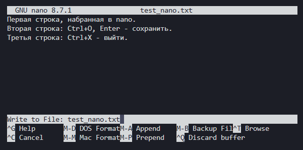

1.1 Первый скрипт

Скриншоты 1.1-2.3 сделаны до того, как файлы были переименованы по частям методички, поэтому в терминале старые имена (`01_hello.sh`, `hello.sh`, `02_sum.sh`, `03_all_ops.sh`, `04_my_math.sh`).

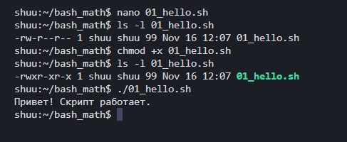

1.2 Задание 1: запуск двумя способами

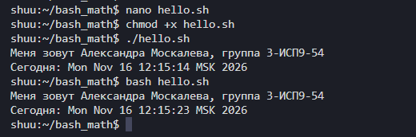

2.1 Сумма

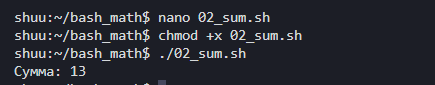

2.2 Все операции

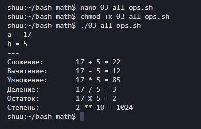

2.3 Задание 2

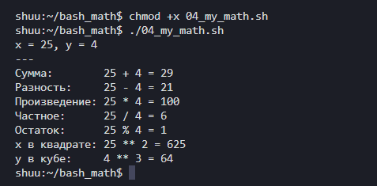

3.1 Переменные

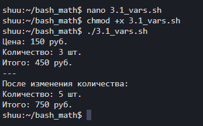

3.2 Счётчик

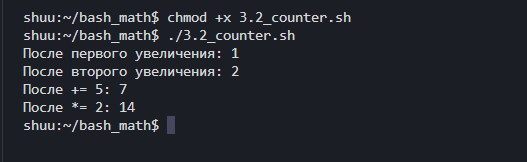

3.3 Задание 3

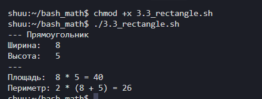

4.1 Ввод чисел

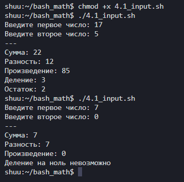

4.2 Задание 4: калькулятор с %

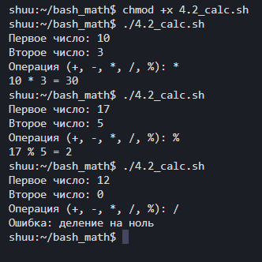

5.1 Задание 5: скидка

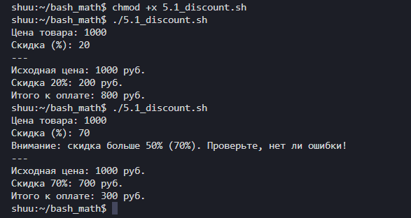

5.2 Задание 6: секунды

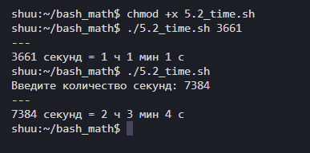

5.3 Задание 7: сумма и факториал

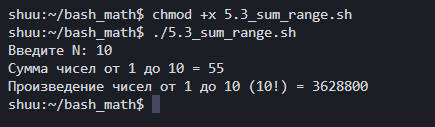

6.1 Площадь круга (bc)

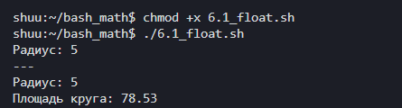

6.2 Задание 8: среднее

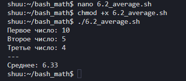

Доп. задание 1

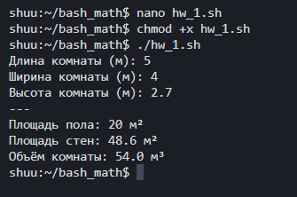

Доп. задание 2

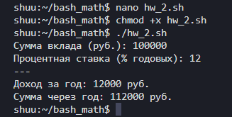

Доп. задание 3

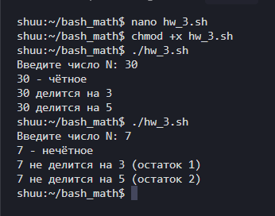

Доп. задание 4

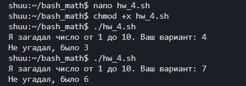
