# Практическая работа «Практические bash-скрипты»

Москалева Александра, группа 3-ИСП9-54

Задание: [bash_practice.md](https://github.com/softboxdev/programming_course/blob/main/practice/bash_practice.md)

## Запуск

Выполняла в Ubuntu (WSL).

```bash
chmod +x *.sh
./1.1_fileinfo.sh
./3.3_menu.sh
```

## Скрипты

Номер в названии - раздел методички и номер скрипта в нём.

1. Работа с файлами:
- `1.1_fileinfo.sh` - информация о файле
- `1.2_filecreate.sh` - создание файла
- `1.3_copybackup.sh` - копирование с бэкапом
- `1.4_filefind.sh` - поиск файлов
- `1.5_filepermissions.sh` - смена прав

2. Работа с сетью:
- `2.1_myip.sh` - мой IP
- `2.2_pingtest.sh` - проверка соединения
- `2.3_portscan.sh` - открытые порты
- `2.4_download.sh` - скачивание файла
- `2.5_netstat.sh` - активные соединения
- `2.6_dnslookup.sh` - DNS
- `2.7_speedtest.sh` - скорость интернета

3. Простые полезные скрипты:
- `3.1_counter.sh` - счётчик
- `3.2_watcher.sh` - слежение за файлом
- `3.3_menu.sh` - меню

## Скриншоты

1.1 Информация о файле

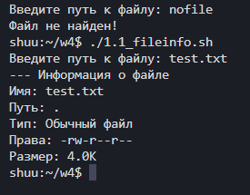

1.2 Создание файла

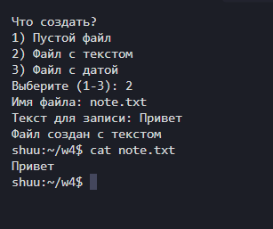

1.3 Копирование с бэкапом

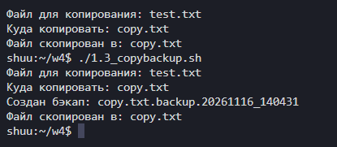

1.4 Поиск файлов

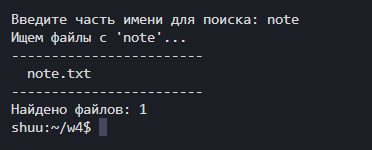

1.5 Изменение прав

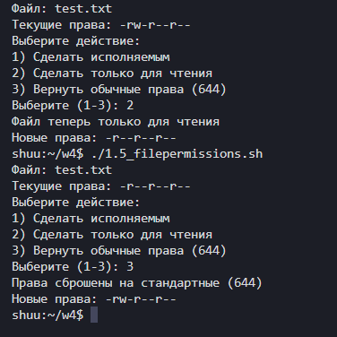

2.1 Мой IP (адреса скрыты)

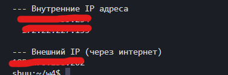

2.2 Проверка соединения

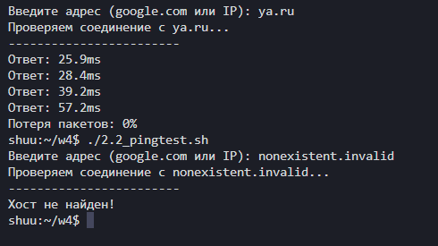

2.3 Открытые порты

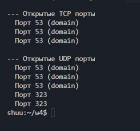

2.4 Скачивание файла

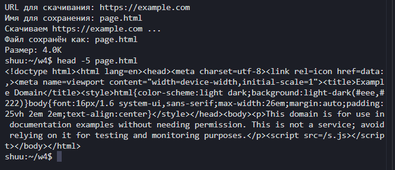

2.5 Сетевые соединения (адреса скрыты)

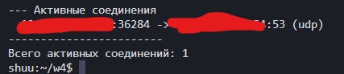

2.6 DNS

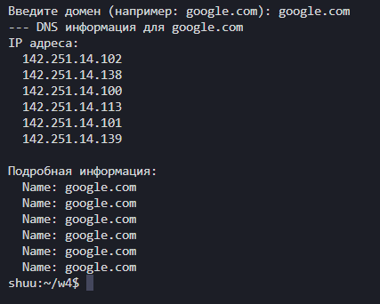

2.7 Тест скорости

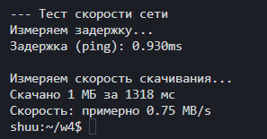

3.1 Счётчик

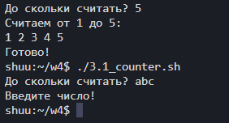

3.2 Слежение за файлом (слева дописываю строку, справа она появляется)

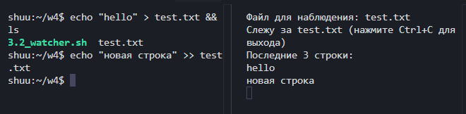

3.3 Меню: пункт 1, дата

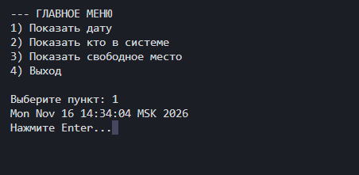

3.3 Меню: пункт 2, кто в системе

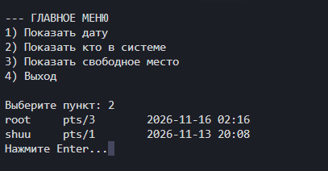

3.3 Меню: пункт 3, свободное место

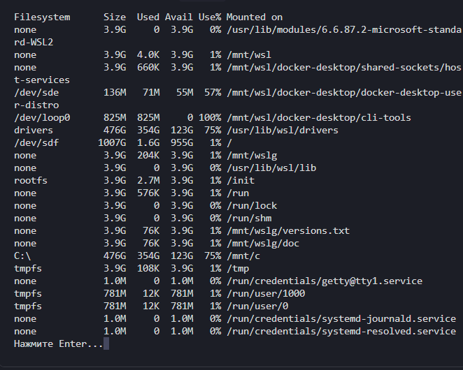

3.3 Меню: пункт 4, выход

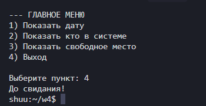
