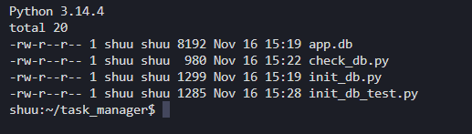
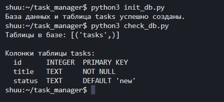
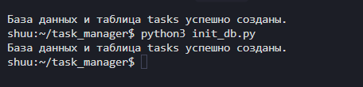
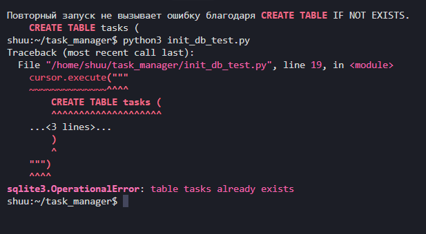

# Практическая работа №1. Инициализация базы данных SQLite

Москалева Александра, группа 3-ИСП9-54

Задание: [01_practice_client_server_app.md](https://github.com/softboxdev/programming_course/blob/main/practice/01_practice_client_server_app.md)

## Файлы

- `init_db.py` - создаёт базу `app.db` и таблицу `tasks`
- `check_db.py` - показывает таблицы и колонки

## Запуск

Выполняла в Ubuntu (WSL), в папке `~/task_manager`, как в методичке.

```bash
python3 init_db.py
python3 check_db.py
```

Повторный запуск `init_db.py` проходит без ошибки, потому что в запросе есть `IF NOT EXISTS`. Без него второй запуск выдаёт `sqlite3.OperationalError: table tasks already exists`.

## Контрольные вопросы

**1. Что произойдёт, если убрать `conn.commit()` из скрипта и запустить его?**
Изменения останутся в незавершённой транзакции и при закрытии соединения отменятся, в файл они не попадут. Я проверила: `INSERT` без `commit()` после переподключения - в таблице 0 строк. А `CREATE TABLE` у меня сохранился и без `commit()`, потому что модуль `sqlite3` по умолчанию сам начинает транзакцию только перед `INSERT`, `UPDATE`, `DELETE`. Поэтому `commit()` лучше писать всегда.

**2. Чем отличается `connection` от `cursor`? Зачем нужны оба?**
`connection` - это подключение к файлу базы. Через него управляют транзакцией (`commit()`, `rollback()`) и закрывают базу (`close()`). `cursor` создаётся из соединения и выполняет запросы (`execute()`), а потом отдаёт результаты (`fetchone()`, `fetchall()`, `lastrowid`, `rowcount`).

**3. Почему `id INTEGER PRIMARY KEY` заполняется автоматически, хотя мы не передаём значение?**
В SQLite колонка `INTEGER PRIMARY KEY` - это то же самое, что встроенный номер строки `rowid`. Если значение не указать, SQLite сам ставит следующее число: максимальный `id` + 1, то есть 1, 2, 3 и так далее.

**4. Что делает `DEFAULT 'new'` в определении колонки `status`?**
Задаёт значение по умолчанию. Если при `INSERT` не указать `status`, туда автоматически запишется `'new'`, то есть новая задача.

**5. Где физически на диске лежат данные таблицы `tasks`?**
В файле `app.db` в той папке, из которой запущен скрипт (путь в `connect('app.db')` относительный). SQLite хранит всю базу в одном файле, отдельный сервер не нужен. Файл можно открыть, например, в DB Browser for SQLite.

## Скриншоты

Шаги 2 и 5. Версия Python и файл app.db после запуска



Шаги 4 и 6. Запуск init_db.py и проверка структуры через check_db.py



Шаг 7. Повторный запуск без ошибки



Шаг 7. Эксперимент: без IF NOT EXISTS повторный запуск даёт ошибку


