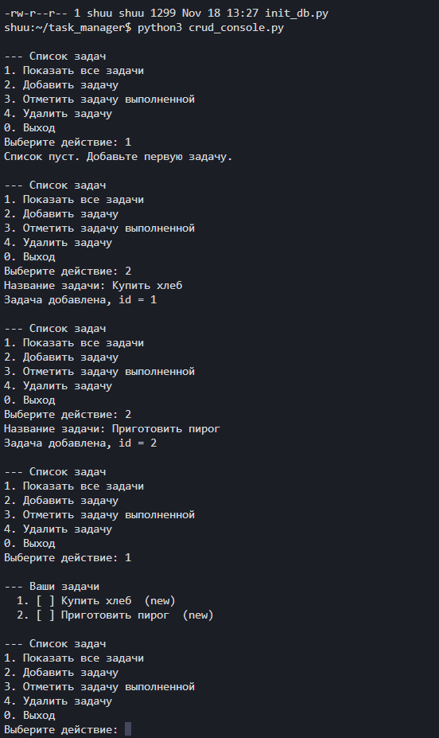
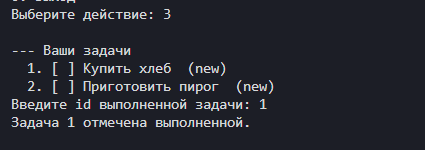
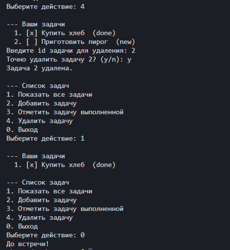
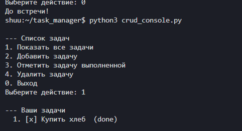
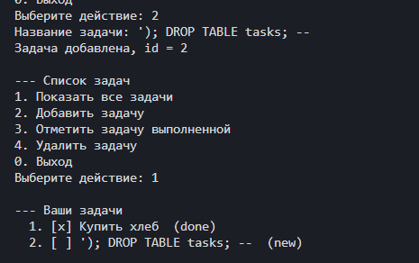
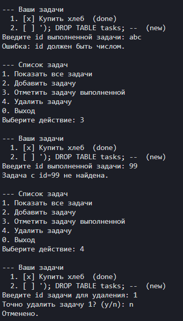
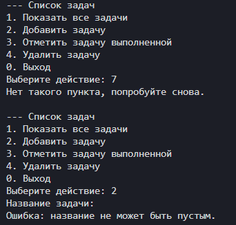

# Практическая работа №2. CRUD через консоль

Москалева Александра, группа 3-ИСП9-54

Задание: [02_practice_client_server_app.md](https://github.com/softboxdev/programming_course/blob/main/practice/02_practice_client_server_app.md)

## Файлы

- `init_db.py`, `check_db.py` - из работы №1
- `crud_console.py` - меню: показать, добавить, выполнить, удалить

## Запуск

Выполняла в Ubuntu (WSL), в той же папке `~/task_manager`, что и работу №1.

```bash
python3 init_db.py
python3 crud_console.py
```

Проверила по шагам 8 и 9 методички: добавление, отметка выполненной, удаление с подтверждением, сохранение после перезапуска. Название `'); DROP TABLE tasks; --` сохранилось как обычный текст, таблица не удалилась. Отдельно проверила ошибки ввода.

## Контрольные вопросы

**1. Почему для `SELECT` не нужен `commit()`, а для `INSERT` нужен?**
`SELECT` только читает и ничего в базе не меняет, фиксировать нечего. `INSERT` меняет данные: перед ним открывается транзакция, и пока не вызван `commit()`, новая строка видна только этому соединению. При закрытии без `commit()` она пропадёт.

**2. Что вернёт `fetchone()`, если в таблице нет строк?**
`None`. Поэтому перед использованием результата его стоит проверять: `if row is None`.

**3. Чем `fetchone()` отличается от `fetchall()` и когда какой использовать?**
`fetchone()` возвращает одну строку (кортеж) или `None`. Его берут, когда ждём одну запись, например `WHERE id = ?` или `SELECT COUNT(*)`. `fetchall()` возвращает список всех строк, он может быть пустым. Его берут, чтобы вывести весь список задач.

**4. Почему `(title,)` - это кортеж, а `(title)` - нет?**
Кортеж в Python делает запятая, а не скобки. `(title)` - это просто строка в скобках, а `(title,)` - кортеж из одного элемента. `execute()` ждёт последовательность параметров. Если передать строку, каждая буква станет отдельным параметром, и будет ошибка `Incorrect number of bindings`.

**5. Что вернёт `cursor.rowcount` после `UPDATE`, если такого id нет?**
`0`. Запрос выполнится без ошибки, но не изменит ни одной строки. По этому значению программа понимает, что задачи нет, и пишет «Задача не найдена».

**6. Зачем проверять `isdigit()` перед `int(input())`?**
Если ввести не число (например, `abc` или пустую строку), `int()` выбросит `ValueError`, и программа упадёт. Проверка `isdigit()` позволяет заранее вывести понятное сообщение и вернуться в меню.

**7. Как параметризованные запросы защищают от SQL-инъекции?**
В запросе стоит `?`, а значение передаётся отдельно. SQLite подставляет его как данные, а не как часть SQL-кода. Поэтому строка `'); DROP TABLE tasks; --` сохраняется как обычное название задачи и не выполняется. Если же собрать запрос через f-строку, введённый текст станет частью SQL и сможет его изменить.

## Скриншоты

Шаг 8. Пустой список и добавление задач



Шаг 8. Отметка задачи выполненной



Шаг 8. Удаление с подтверждением



Шаг 8. Перезапуск: задача сохранилась



Шаг 9. SQL-инъекция сохранилась как обычный текст



Ошибки ввода: не число, несуществующий id, отмена удаления



Ошибки ввода: несуществующий пункт меню, пустое название


