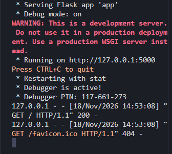
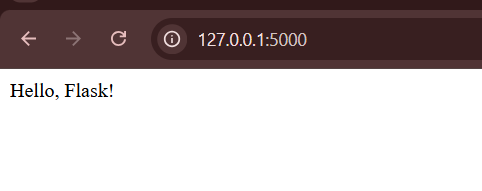
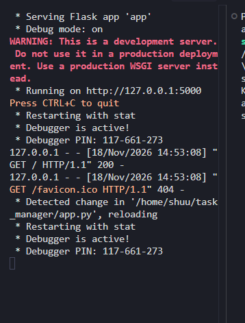
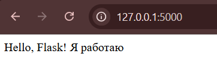
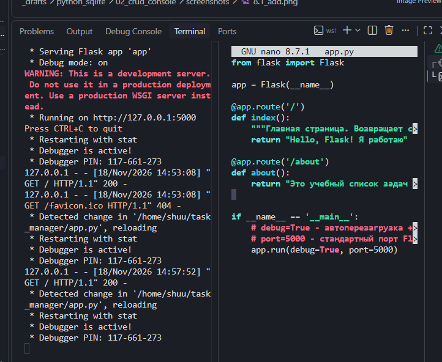
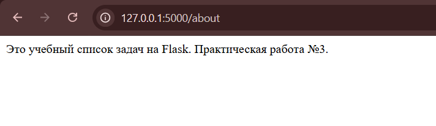
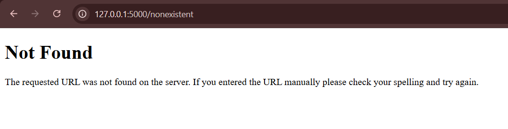
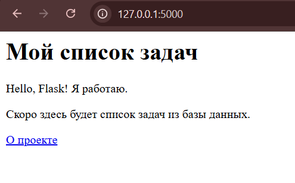

# Практическая работа №3. Flask, первый маршрут

Москалева Александра, группа 3-ИСП9-54

Задание: [03_practice_client_server_app.md](https://github.com/softboxdev/programming_course/blob/main/practice/03_practice_client_server_app.md)

## Файлы

- `app.py` - приложение Flask, маршруты `/` и `/about`
- `requirements.txt` - Flask
- `templates/` - папка для шаблонов
- `init_db.py`, `check_db.py`, `crud_console.py` - из прошлых работ

## Запуск

Выполняла в Ubuntu (WSL), в папке `~/task_manager`. Flask ставила в виртуальное окружение, потому что в Ubuntu `pip` вне окружения не устанавливает пакеты.

```bash
sudo apt install -y python3-venv
python3 -m venv venv
source venv/bin/activate
pip install -r requirements.txt
python3 app.py
```

Открыть http://127.0.0.1:5000 в браузере. При изменении `app.py` сервер перезапускается сам (`debug=True`). Красное предупреждение WARNING при запуске означает, что это сервер для разработки, а не для настоящего сайта.

## Контрольные вопросы

**1. Что делает декоратор `@app.route('/')`?**
Связывает адрес `/` с функцией, которая написана под ним. Когда браузер открывает этот адрес, Flask вызывает функцию и отправляет то, что она вернула, обратно в браузер как ответ.

**2. Чем `GET` отличается от `POST`? Какой метод используется по умолчанию?**
`GET` запрашивает страницу или данные, параметры передаются в адресе. `POST` отправляет данные на сервер в теле запроса, например при отправке формы, и обычно что-то меняет. По умолчанию маршрут во Flask принимает только `GET`, на `POST` будет ошибка 405.

**3. Зачем нужен `debug=True` и почему его нельзя использовать на реальном сервере?**
В режиме отладки сервер сам перезапускается при изменении кода и показывает подробную ошибку прямо в браузере. На настоящем сервере это опасно: через отладчик можно выполнить любой Python-код на сервере, а текст ошибок показывает устройство программы.

**4. Что означает адрес `127.0.0.1:5000`?**
`127.0.0.1` - это localhost, то есть этот же компьютер. `5000` - номер порта, на котором Flask ждёт запросы. С других компьютеров такой сервер недоступен.

**5. Почему при открытии `/nonexistent` мы получаем 404, а не ошибку Python?**
Flask ищет маршрут для адреса среди зарегистрированных. Если такого нет, никакая функция не вызывается, и Flask сам возвращает ответ `404 Not Found`. Это обычная ситуация, а не ошибка в коде.

**6. Почему папка для HTML-шаблонов должна называться именно `templates`?**
Так принято во Flask: `render_template()` по умолчанию ищет шаблоны в папке `templates` рядом с `app.py`. Если назвать по-другому, будет ошибка `TemplateNotFound`. Папку можно поменять явно: `Flask(__name__, template_folder='html')`.

**7. Что произойдёт, если запустить два сервера Flask одновременно на одном порту?**
Второй не запустится, потому что порт уже занят первым. Будет ошибка `Address already in use`. Нужно остановить первый сервер (`Ctrl+C`) или запустить второй на другом порту, например `port=5001`.

## Скриншоты

Шаг 4. Запуск сервера



Шаг 5. Первая страница в браузере



Шаг 6. Сервер сам перезапустился после изменения app.py



Шаг 6. Новый текст после обновления страницы



Шаг 7. Добавила маршрут /about



Шаг 7. Страница /about



Шаг 8. Несуществующий адрес: 404



Шаг 10. HTML-страница со ссылкой «О проекте»


