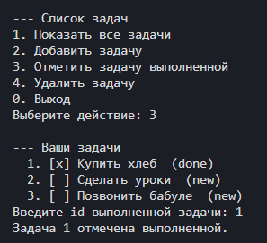
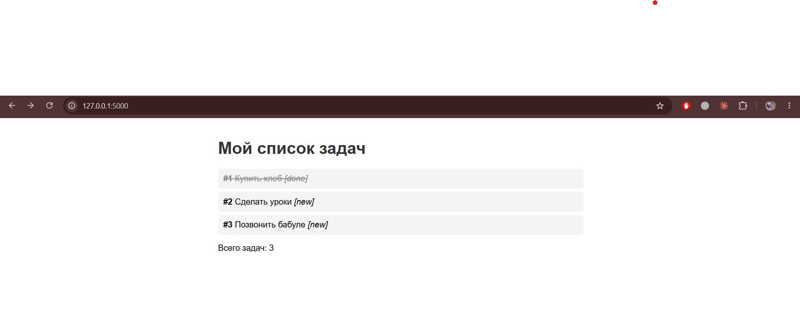
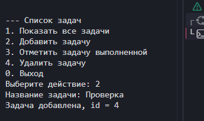
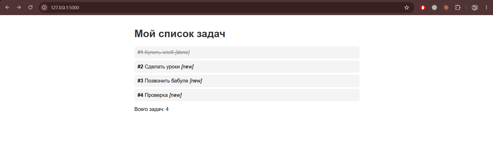
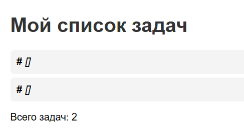

# Практическая работа №4. Flask + SQLite: чтение данных

Москалева Александра, группа 3-ИСП9-54

Задание: [04_practice_client_server_app.md](https://github.com/softboxdev/programming_course/blob/main/practice/04_practice_client_server_app.md)

## Файлы

- `app.py` - читает задачи из базы и передаёт в шаблон
- `templates/index.html` - список задач
- `init_db.py`, `check_db.py`, `crud_console.py` - из прошлых работ

## Запуск

Выполняла в Ubuntu (WSL), в папке `~/task_manager`, Flask стоит в окружении `venv` из работы №3.

```bash
source venv/bin/activate
python3 crud_console.py
python3 app.py
```

Открыть http://127.0.0.1:5000. Выполненные задачи зачёркнуты, при пустой базе выводится «Список пуст». Задача, добавленная через `crud_console.py` во втором терминале, появляется после обновления страницы, сервер перезапускать не нужно.

В шаге 7 у меня не было ошибки `UndefinedError`, как в методичке: в Flask 3.1 Jinja2 просто выводит пустые значения, поэтому без `row_factory` на странице остались строки без номера, названия и статуса.

## Контрольные вопросы

**1. Зачем нужен шаблонизатор Jinja2, если можно вернуть HTML-строку из функции?**
Чтобы HTML был отдельно от Python-кода. Шаблон лежит в своём `.html` файле, его проще читать и править, редактор подсвечивает разметку. Ещё Jinja2 сам экранирует выводимые данные, и это защищает от XSS.

**2. Чем `{{ ... }}` отличается от `` в Jinja2?**
`{{ ... }}` выводит значение на страницу. `` - это команды шаблона: циклы `for`, условия `if`, блоки. Сами они ничего на страницу не выводят.

**3. Что делает `render_template('index.html', items=rows)`?**
Берёт файл `templates/index.html`, передаёт в него переменную `items` со значением `rows` и собирает готовый HTML. Этот HTML Flask отправляет браузеру.

**4. Почему при чтении данных не нужен `conn.commit()`?**
`SELECT` ничего не меняет в базе, поэтому фиксировать нечего. `commit()` нужен только после `INSERT`, `UPDATE`, `DELETE`.

**5. Что такое `sqlite3.Row` и почему `item.title` работает только с ним?**
`sqlite3.Row` - формат строки результата, где к полю можно обратиться и по номеру (`row[1]`), и по имени (`row['title']`). Jinja2 для `item.title` ищет поле `title` по имени. У обычного кортежа имён нет, только номера, поэтому без `sqlite3.Row` поля на странице выводятся пустыми (шаг 7).

**6. Куда Flask кладёт файлы шаблонов по умолчанию и можно ли это изменить?**
В папку `templates` рядом с `app.py`. Изменить можно так: `Flask(__name__, template_folder='другая_папка')`.

**7. Что выведет шаблон, если `items` - пустой список?**
Пустой список считается ложным значением, поэтому `` не выполнится и сработает ветка ``. На странице будет «Список пуст. Добавь первую задачу!».

## Скриншоты

Шаг 1. Задачи в базе



Шаг 4. Список задач в браузере, выполненная зачёркнута



Шаг 5. Добавила задачу через консоль, не останавливая сервер



Шаг 5. После обновления страницы новая задача появилась



Шаг 6. Пустая база


Шаг 7. Без row_factory поля пустые


