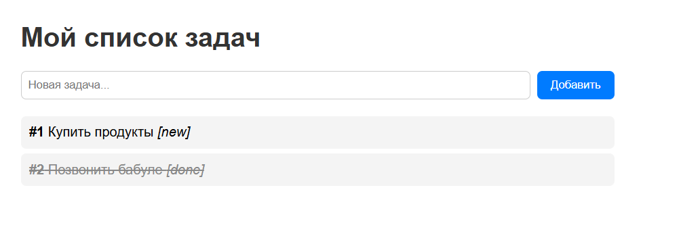
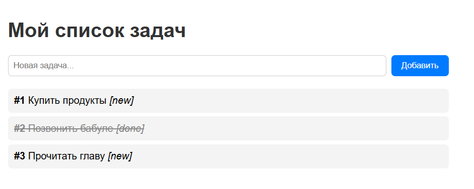
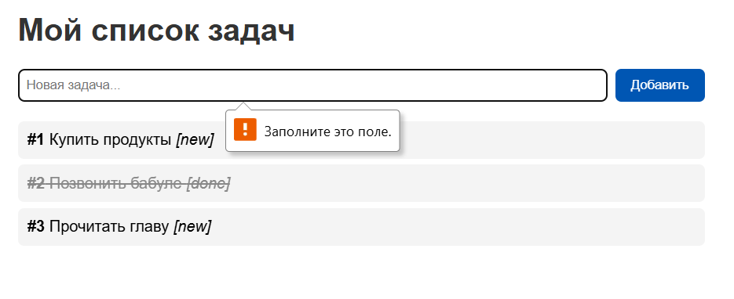
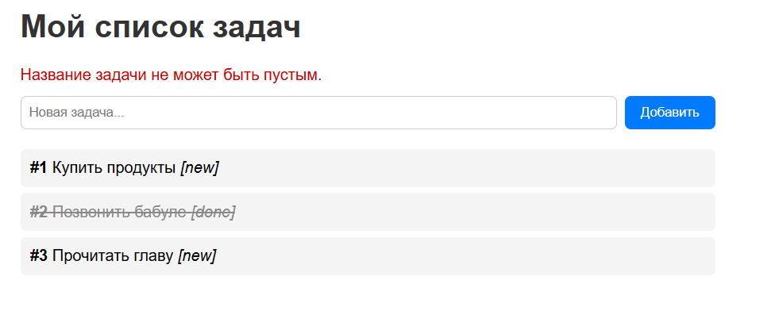
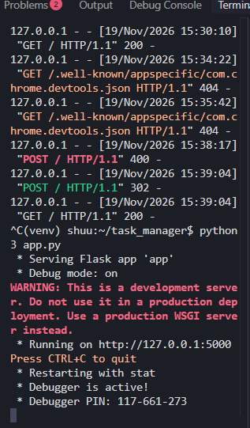
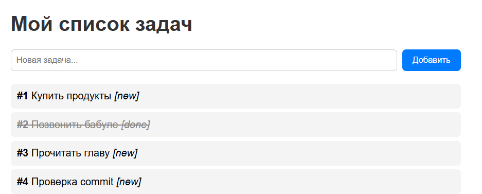
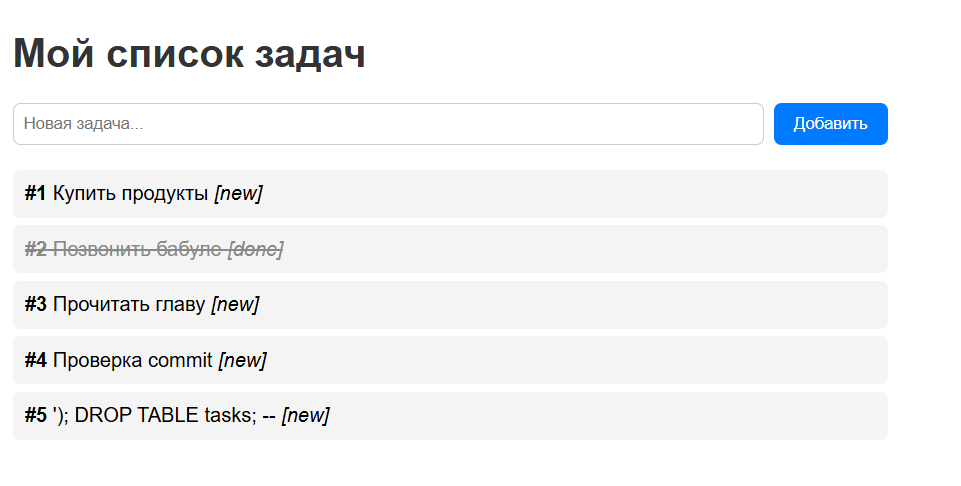
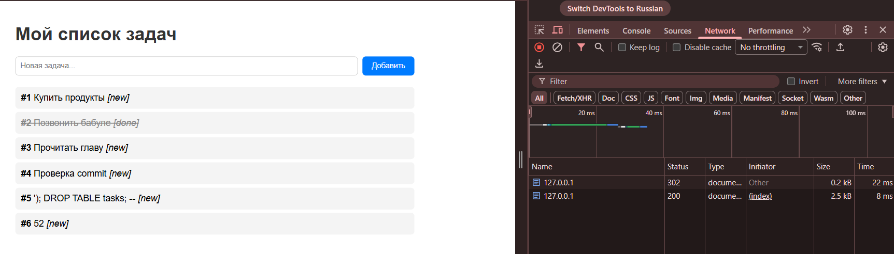

# Практическая работа №5. Flask + SQLite: добавление данных

Москалева Александра, группа 3-ИСП9-54

Задание: [05_practice_client_server_app.md](https://github.com/softboxdev/programming_course/blob/main/practice/05_practice_client_server_app.md)

## Файлы

- `app.py` - маршрут `/` принимает GET и POST, добавляет задачу и делает redirect
- `templates/index.html` - форма и список задач
- `init_db.py`, `check_db.py`, `crud_console.py` - из прошлых работ

## Запуск

Выполняла в Ubuntu (WSL), в папке `~/task_manager`, Flask стоит в окружении `venv` из работы №3.

```bash
source venv/bin/activate
python3 app.py
```

Проверила: задача добавляется, после F5 не дублируется, пустое название не проходит, `'); DROP TABLE tasks; --` сохраняется как текст, после перезапуска сервера задачи на месте. На пустое название сервер отвечает кодом 400, в терминале это строка `"POST / HTTP/1.1" 400`.

## Контрольные вопросы

**1. Чем POST принципиально отличается от GET и почему формы отправляют именно POST?**
GET только получает данные, параметры видны в адресе, и такой запрос можно повторять сколько угодно. POST отправляет данные в теле запроса и меняет что-то на сервере. Форма добавляет задачу в базу, поэтому отправляется через POST. Так данные не попадают в адрес и историю браузера.

**2. Что произойдёт, если убрать `methods=['GET', 'POST']` из маршрута?**
Маршрут будет принимать только GET. Страница откроется, но при отправке формы Flask вернёт `405 Method Not Allowed`, и задача не добавится.

**3. Зачем нужен паттерн Post/Redirect/Get? Что сломается без него?**
После POST сервер делает redirect, и браузер открывает страницу уже через GET. Без этого при нажатии F5 браузер спросит про повторную отправку формы, и задача добавится второй раз.

**4. Почему `url_for('index')` лучше, чем жёсткая строка `'/'`?**
`url_for` строит адрес по имени функции. Если потом поменять путь в `@app.route`, ссылки и редиректы не сломаются, их не нужно искать и исправлять по всему коду.

**5. Почему `request.form.get('title', '')` безопаснее, чем `request.form['title']`?**
Если поля `title` в запросе нет, `request.form['title']` вызовет ошибку 400. А `.get('title', '')` просто вернёт пустую строку, и мы сами покажем понятное сообщение.

**6. Зачем нужна серверная валидация, если в HTML уже есть `required`?**
`required` работает только в браузере, его легко обойти: убрать атрибут в DevTools или отправить запрос через curl. Ещё он пропускает строку из одних пробелов. Поэтому на сервере проверяем ещё раз: `title.strip()` не должен быть пустым.

**7. В каком порядке идут транзакции при добавлении задачи через форму?**
Браузер отправляет `POST /` с полем `title`. Сервер проверяет название, открывает соединение, выполняет `INSERT`, делает `commit()` и закрывает соединение. Потом возвращает redirect (302), браузер делает `GET /` и показывает обновлённый список.

## Скриншоты

Шаги 1-2. Форма над списком задач



Шаг 3. Добавила задачу через форму



Шаг 3. Пустое поле: браузер не отправляет форму (required)



Шаг 3. Обход required: ошибку показал сервер



Шаг 4. Остановила и снова запустила сервер



Шаг 4. После перезапуска задача «Проверка commit» на месте



Шаг 5. SQL-инъекция сохранилась как обычный текст



Шаг 6. DevTools: POST с ответом 302, затем GET с ответом 200


