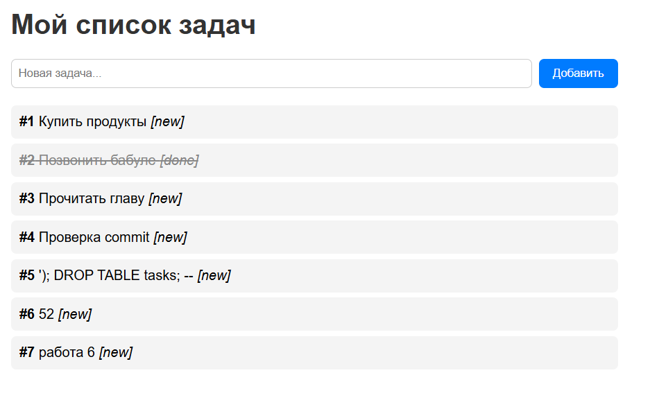
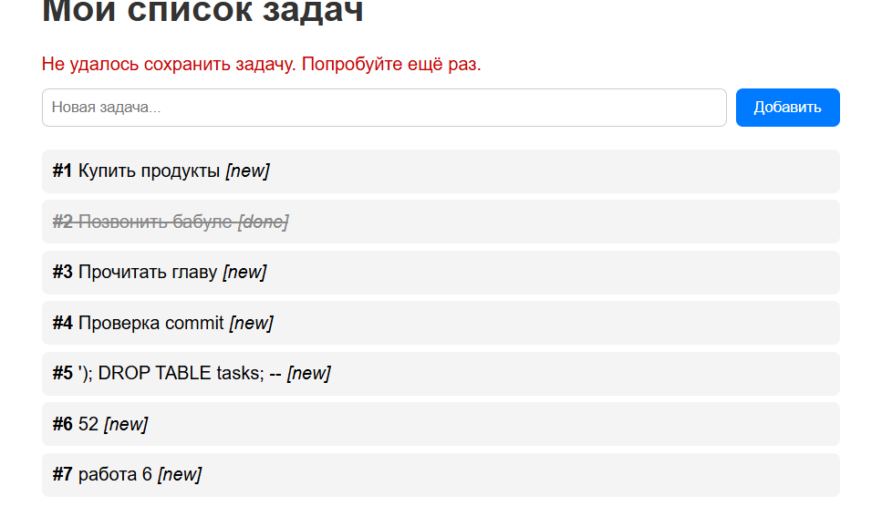
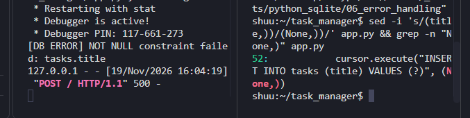
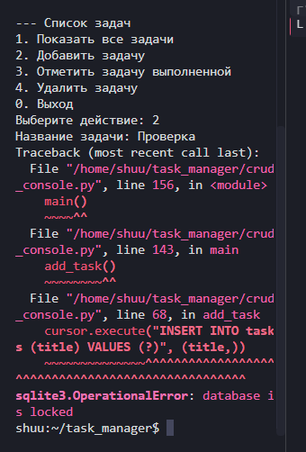
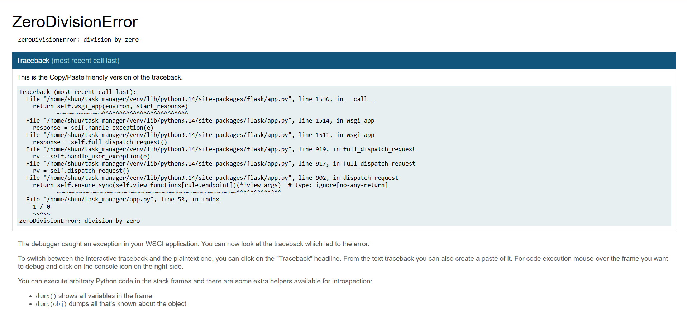
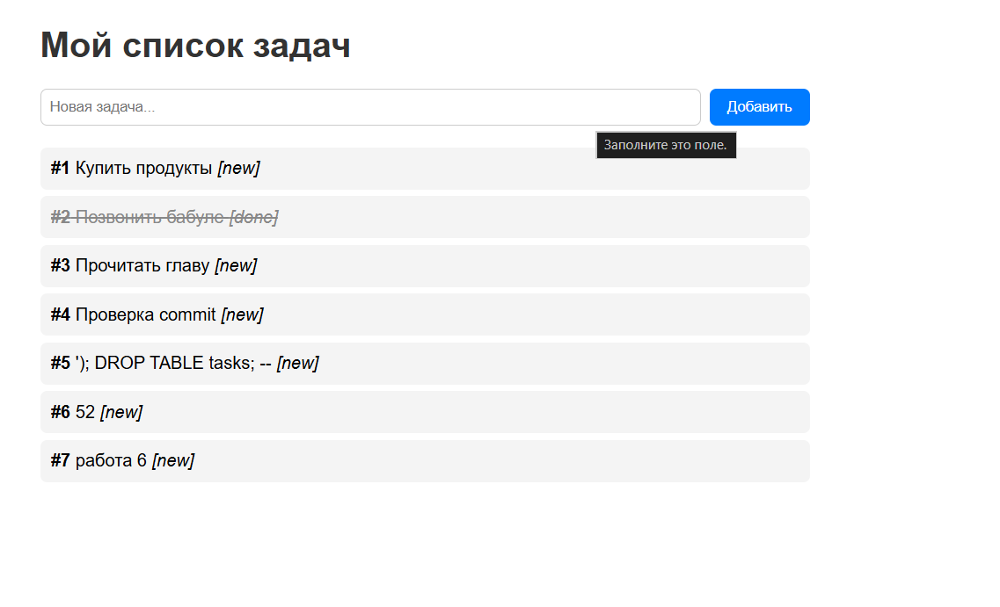
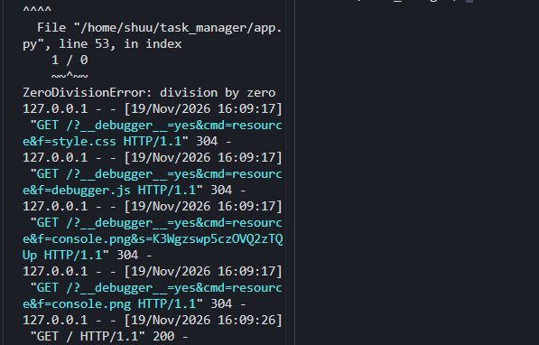

# Практическая работа №6. Обработка ошибок и защита соединений

Москалева Александра, группа 3-ИСП9-54

Задание: [06_practice_client_server_app.md](https://github.com/softboxdev/programming_course/blob/main/practice/06_practice_client_server_app.md)

## Файлы

- `app.py` - работа с базой через `try / except / finally`
- `templates/index.html` - форма, список и сообщение об ошибке
- `init_db.py`, `check_db.py`, `crud_console.py` - из прошлых работ

## Запуск

Выполняла в Ubuntu (WSL), в папке `~/task_manager`, Flask стоит в окружении `venv` из работы №3.

```bash
source venv/bin/activate
python3 app.py
```

## Эксперименты

1. `(title,)` заменила на `(None,)`: на странице «Не удалось сохранить задачу», в консоли `NOT NULL constraint failed`, сервер работает, количество задач не изменилось.
2. Убрала `finally` вместе с `conn.close()`: если оставить `rollback()`, база не блокируется, он сам завершает транзакцию. Поэтому убрала и `rollback()`, тогда после ошибки `crud_console.py` не может добавить задачу: `database is locked`.
3. `1 / 0` между `execute` и `commit`: `except sqlite3.Error` такую ошибку не ловит, открывается страница отладчика с `ZeroDivisionError`. Задача при этом не сохранилась, потому что `commit()` не выполнился, а `finally` закрыл соединение.

## Контрольные вопросы

**1. Почему `conn.close()` нельзя оставлять просто в конце функции, а нужно помещать в `finally`?**
Если в середине функции будет ошибка, выполнение до последней строки не дойдёт, и соединение останется открытым. Тогда база может оказаться заблокированной (`database is locked`). Блок `finally` выполняется всегда, и при ошибке, и без неё, поэтому `close()` ставят туда.

**2. Что делает `conn.rollback()` и в каком случае он вызывается?**
Отменяет все изменения текущей транзакции, которые ещё не зафиксированы `commit()`. Его вызывают в `except`, когда при работе с базой произошла ошибка, чтобы в базе не осталось наполовину выполненных изменений.

**3. Почему `conn` нужно открывать до `try`, а не внутри?**
Если `connect()` стоит внутри `try` и сам упадёт, переменной `conn` не будет, и в `finally` вызов `conn.close()` даст новую ошибку `NameError`. Если открыть соединение до `try`, в `finally` оно точно существует.

**4. Чем `except sqlite3.Error` лучше, чем `except:` без указания типа?**
`except sqlite3.Error` ловит только ошибки базы данных, а остальные ошибки (например, опечатку в коде) не прячет. Голый `except:` ловит вообще всё, даже `Ctrl+C`, и из-за этого настоящие ошибки сложно найти.

**5. Что произойдёт с данными, если `execute` прошёл, а `commit` упал?**
Данные не сохранятся. `execute` сделал изменения только внутри транзакции, а без успешного `commit()` они откатываются. В базе всё останется как было до запроса.

**6. Зачем в веб-приложении возвращать пользователю понятное сообщение вместо стектрейса?**
Пользователю стектрейс ничего не объясняет, а сообщение «Не удалось сохранить задачу» понятно. Ещё стектрейс показывает устройство программы (пути, куски кода, запросы), и этим может воспользоваться злоумышленник. Подробности ошибки пишем в консоль сервера.

**7. Как проверить, что `rollback` действительно откатил транзакцию?**
Посчитать задачи до и после ошибки (`SELECT COUNT(*)`), количество не должно измениться. Я проверила так в эксперименте с `None` вместо названия: было 7 задач, после ошибки осталось 7. И база после этого не заблокирована, `crud_console.py` открывает её без проблем.

## Скриншоты

Шаг 4. Обновлённый app.py: задача добавляется как раньше



Шаг 5. Эксперимент 1: вместо стектрейса понятное сообщение



Шаг 5. Эксперимент 1: ошибка NOT NULL в консоли сервера



Шаг 6. Эксперимент 2: без finally и rollback база заблокирована



Шаг 7. Эксперимент 3: ZeroDivisionError не пойман except sqlite3.Error



Шаг 7. Эксперимент 3: задача не сохранилась



Шаг 7. Эксперимент 3: ошибка в консоли сервера


