# Практическая работа №7. Мини-проект «Список задач»

Москалева Александра, группа 3-ИСП9-54

Задание: [07_practice_client_server_app.md](https://github.com/softboxdev/programming_course/blob/main/practice/07_practice_client_server_app.md)

## Что умеет

- показывает список задач и счётчик выполненных
- добавляет задачу через форму
- переключает статус (Готово / Вернуть)
- удаляет задачу с подтверждением

## Файлы

- `app.py` - приложение
- `templates/index.html` - страница
- `init_db.py`, `check_db.py`, `crud_console.py` - из прошлых работ

## Запуск

Выполняла в Ubuntu (WSL), в папке `~/task_manager`, Flask стоит в окружении `venv` из работы №3.

```bash
source venv/bin/activate
python3 app.py
```

Открыть http://127.0.0.1:5000. Таблица создаётся сама при запуске. Вместо значков из методички на кнопках слова «Готово», «Вернуть», «Удалить», сверху добавила счётчик выполненных задач.

## Контрольные вопросы

**1. Почему действия «переключить статус» и «удалить» отправляются через POST-форму, а не через `<a href>`?**
Ссылка `<a href>` отправляет GET, а GET не должен ничего менять. Такую ссылку браузер может открыть сам (предзагрузка), её может открыть поисковый робот, или пользователь случайно нажмёт её ещё раз. Действия, которые меняют данные, отправляются через POST.

**2. Что делает конвертер `<int:task_id>` в маршруте и почему с ним не нужен `isdigit()`?**
Он пропускает в маршрут только целые числа и сразу превращает их в `int`. Если в адресе не число (например, `/toggle/abc`), Flask сам вернёт 404, и функция не вызовется. Поэтому проверять `isdigit()` вручную не нужно.

**3. Что означает `rowcount = 0` после `UPDATE` или `DELETE`?**
Что ни одна строка не изменилась, то есть задачи с таким id нет. Тогда приложение показывает сообщение «Задача #N не найдена».

**4. Почему каждая функция работы с базой открывает своё соединение, а не получает его параметром?**
Так каждая функция сама отвечает за своё соединение: открыла, сделала запрос, закрыла в `finally`. Соединение не живёт дольше, чем нужно, и база не остаётся заблокированной. Во Flask каждый запрос обрабатывается отдельно, поэтому одно общее соединение на всё приложение делать нельзя.

**5. Где в `toggle_task_status` находится `commit()`, и почему без него статус не сохранится после перезапуска?**
`commit()` стоит сразу после `UPDATE` внутри `try`. Без него изменение останется в незавершённой транзакции и при закрытии соединения откатится, поэтому после перезапуска статус будет старым.

**6. Что произойдёт, если открыть `/delete/3` в адресной строке браузера (GET)?**
Flask вернёт `405 Method Not Allowed`, потому что маршрут принимает только POST. Задача не удалится. Я проверила это на `/delete/1`.

**7. Зачем в шаблоне `onsubmit="return confirm(...)"` и можно ли обойти эту защиту?**
Чтобы не удалить задачу случайно: браузер спрашивает «Удалить задачу?», и при «Отмена» форма не отправляется. Это защита только от случайного клика. Её легко обойти: отключить JavaScript или отправить POST через curl. Поэтому главные проверки делаются на сервере.

**8. Почему `return redirect(url_for('index'))` стоит после `try/finally`, а не внутри `try`?**
Redirect означает, что всё прошло успешно, поэтому он выполняется только когда работа с базой закончилась без ошибок. При ошибке выполнение уходит в `except` и возвращает страницу с сообщением, до redirect не доходит. К моменту redirect соединение уже закрыто в `finally`.

## Скриншоты

Шаг 4. Добавила задачу «купить хлеб»

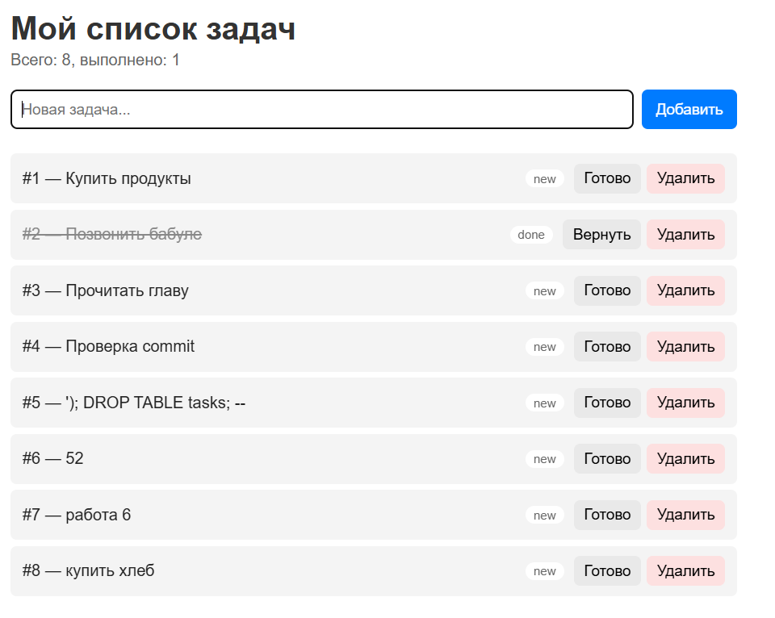

Шаг 4. Кнопка «Готово»: задача зачёркнута, статус done

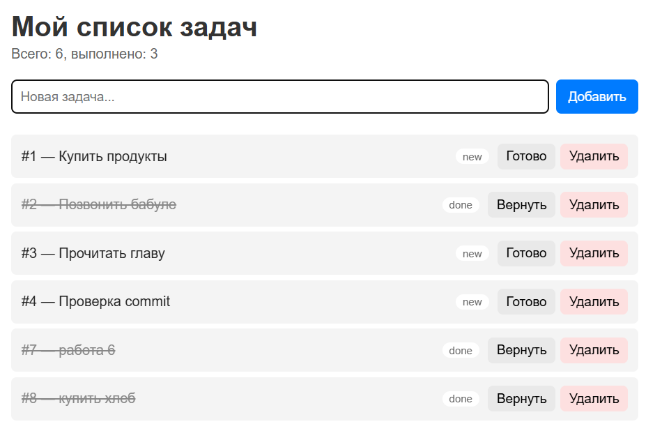

Шаг 4. Кнопка «Вернуть»: статус снова new

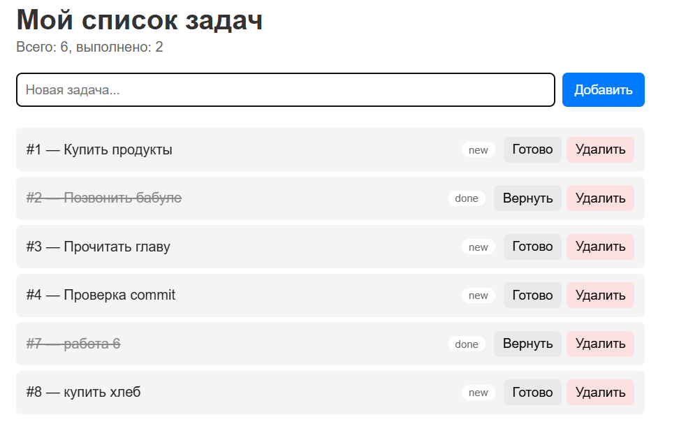

Шаг 4. Удаление с подтверждением

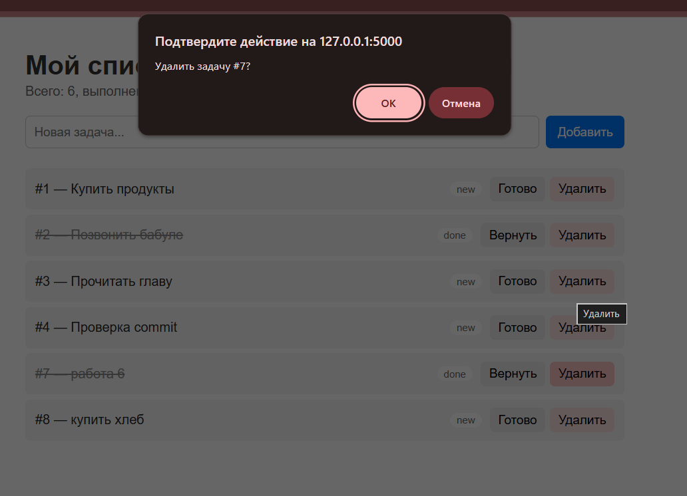

Шаг 4. Задача удалена

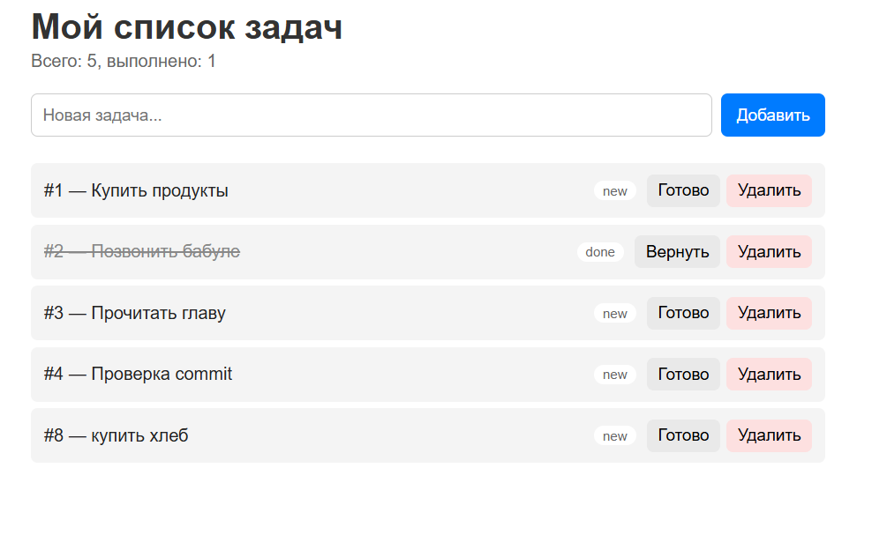

Шаг 5. Сверка с базой через crud_console.py

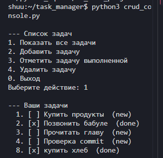

Шаг 6.1. GET на /delete/1: 405 Method Not Allowed

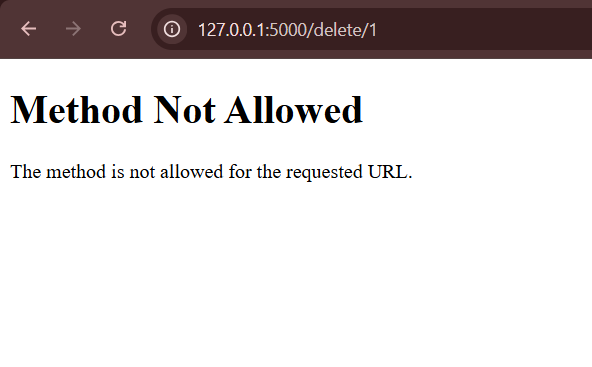

Шаг 6.2. Удалила задачу #4 через консоль

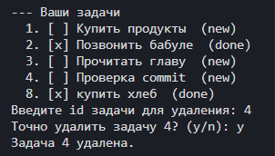

Шаг 6.2. Нажала «Готово» у удалённой задачи: «Задача #4 не найдена»

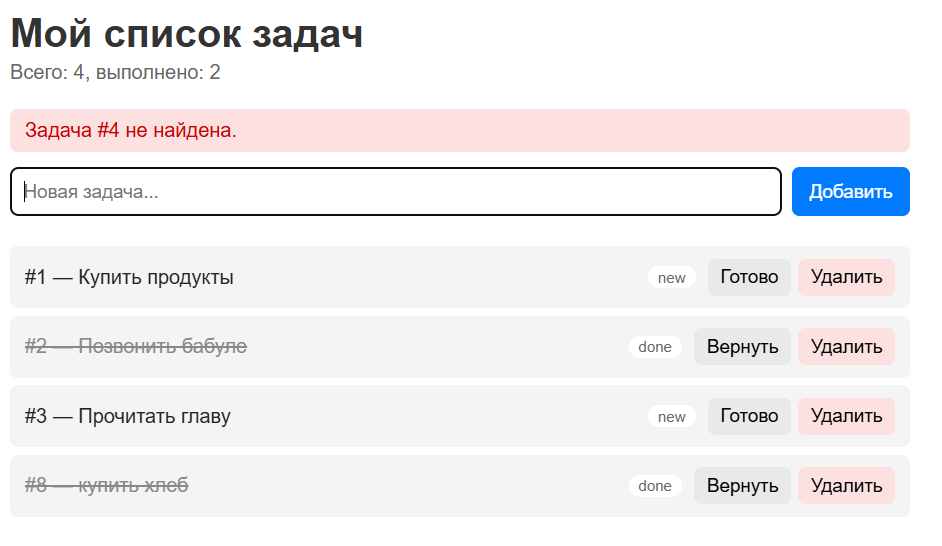

Шаг 6.3. /toggle/abc: 404 Not Found

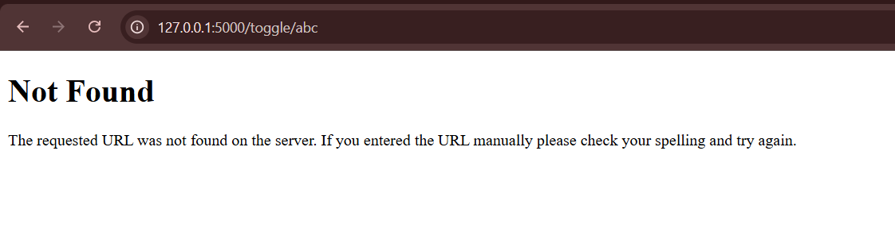

Шаг 6.4. SQL-инъекция сохранилась как текст

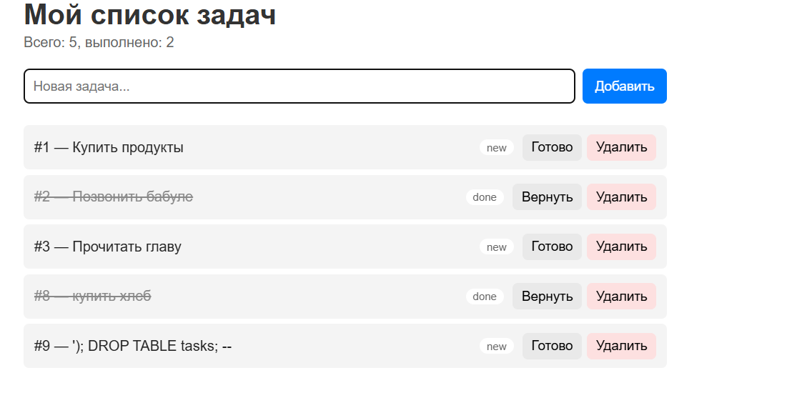

Шаг 7. Без rollback и с None: сообщение об ошибке

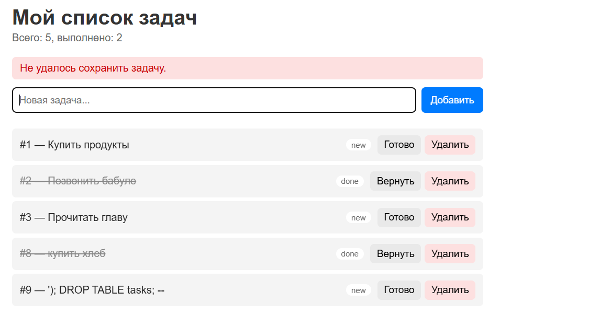

Шаг 7. Ошибка NOT NULL в консоли сервера

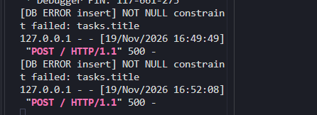

Шаг 8. После серии ошибок база не заблокирована, задача добавляется из консоли

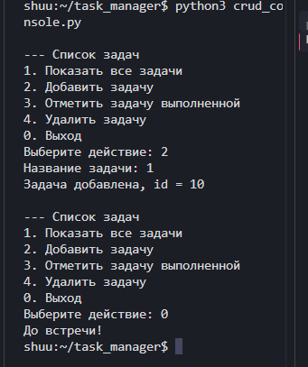
